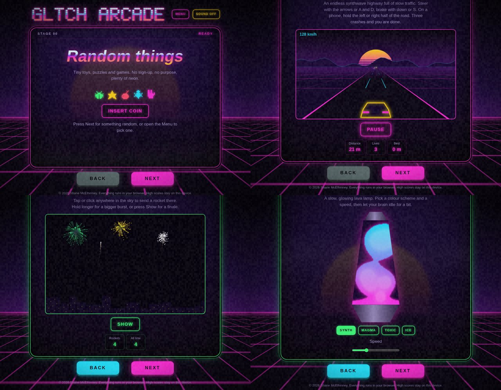

# Gltch Arcade

A neon, 80s-style arcade cabinet in a single HTML file. Fifty-five tiny games, puzzles, toys and oracles with fluid animations, CRT fuzz and synthesised sound. No frameworks, no build step, no tracking.



**Play it:** https://shanemc92.github.io/gltch-arcade/

## Highlights

- **One file.** `index.html` (about 305 KB) holds all the CSS, JavaScript, pixel art and the hand-made pixel font.
- **No dependencies, no network.** Nothing is fetched after the page loads, so it works offline.
- **Shareable links.** Every cabinet has its own address, such as `#snake` or `#beat-lane`, and the Menu lists all of them.
- **Synthesised sound.** Every bleep, drum and chord is generated with the Web Audio API. Sound stays off until you switch it on.
- **Keyboard, mouse and touch.** Canvas games have touch controls, and `prefers-reduced-motion` is respected.
- **Private by default.** High scores, the shared chip bank and your Pixel Pad drawing live in `localStorage` on your device and nowhere else.

## The cabinets

Press **Next** for something random, or open the **Menu** to pick one. Next never repeats a cabinet until you have seen them all.

### Arcade and table games (19)

| Cabinet | What it is |
|---|---|
| [Beat Lane](https://shanemc92.github.io/gltch-arcade/#beat-lane) | Hit each note as it crosses the line. Keys D, F, J and K, or tap the lanes. |
| [Blackjack](https://shanemc92.github.io/gltch-arcade/#blackjack) | Get closer to 21 than the dealer without going over. |
| [Brick Glitch](https://shanemc92.github.io/gltch-arcade/#brick-glitch) | Smash every brick. Catch the falling capsules: M splits the ball, W widens the paddle, L fires lasers. |
| [Bug Whacker](https://shanemc92.github.io/gltch-arcade/#bug-whacker) | Bugs pop out of the holes. Bop them before they hide. |
| [Byte Maze](https://shanemc92.github.io/gltch-arcade/#byte-maze) | Collect every data bit while the bugs hunt you down. |
| [Cave Flyer](https://shanemc92.github.io/gltch-arcade/#cave-flyer) | One button. Hold to climb, let go to drop, and thread the neon cave as it narrows. |
| [Drop Four](https://shanemc92.github.io/gltch-arcade/#drop-four) | Line up four discs in a row, column or diagonal before the CPU does. |
| [Higher or Lower](https://shanemc92.github.io/gltch-arcade/#higher-or-lower) | Will the next card be higher or lower? Aces are low. |
| [Mainframe Breach](https://shanemc92.github.io/gltch-arcade/#mainframe-breach) | Type each command before the trace finds you. |
| [Neon Drive](https://shanemc92.github.io/gltch-arcade/#neon-drive) | An endless synthwave highway full of slow traffic. |
| [Neon Pong](https://shanemc92.github.io/gltch-arcade/#neon-pong) | First to 7 wins. Your paddle is on the left: move the mouse or a finger over the court, or use W and S or the arrow keys. |
| [Peg Drop](https://shanemc92.github.io/gltch-arcade/#peg-drop) | Pick a bet, drop a ball and watch it bounce through the pegs into a multiplier. |
| [Rock Paper Scissors Lizard Spock](https://shanemc92.github.io/gltch-arcade/#rock-paper-scissors-lizard-spock) | The expanded edition: five moves, ten rules, zero mercy. |
| [Shard Storm](https://shanemc92.github.io/gltch-arcade/#shard-storm) | Crystal shards and bugs swoop in from above, and some of them dive. |
| [Snake](https://shanemc92.github.io/gltch-arcade/#snake) | Eat, grow, and keep off the walls and your own tail. |
| [Stack Tower](https://shanemc92.github.io/gltch-arcade/#stack-tower) | Drop each sliding block onto the tower. Anything hanging over the edge gets sliced off. |
| [Target Lock](https://shanemc92.github.io/gltch-arcade/#target-lock) | Hit the targets before they shrink away. Smaller hits score more, and misses cost you accuracy. |
| [Texas Hold’em](https://shanemc92.github.io/gltch-arcade/#texas-holdem) | Heads-up limit Hold’em against a CPU that does its maths. |
| [Tic-Tac-Toe](https://shanemc92.github.io/gltch-arcade/#tic-tac-toe) | You against a CPU that has never lost. A draw is a moral victory. |

### Brain teasers and puzzles (17)

| Cabinet | What it is |
|---|---|
| [80s Trivia](https://shanemc92.github.io/gltch-arcade/#80s-trivia) | Ten questions drawn from sixty, all about the decade of neon, synths and shoulder pads. |
| [Blackout](https://shanemc92.github.io/gltch-arcade/#blackout) | Every tap flips that light and the ones touching it. |
| [Brainteasers](https://shanemc92.github.io/gltch-arcade/#brainteasers) | Have a proper think, then tap the card to check. |
| [Chroma Flip](https://shanemc92.github.io/gltch-arcade/#chroma-flip) | Every tap pushes that tile and the ones touching it on to the next colour: pink, then cyan, then yellow, then round again. |
| [Code Cracker](https://shanemc92.github.io/gltch-arcade/#code-cracker) | Crack the 4-digit code in 10 tries. No digit repeats. |
| [Defuse](https://shanemc92.github.io/gltch-arcade/#defuse) | Clear the board without touching a bomb. Numbers count the bombs touching that square. |
| [Echo](https://shanemc92.github.io/gltch-arcade/#echo) | Watch the pads light up, then play the pattern back. |
| [Footsteps Illusion](https://shanemc92.github.io/gltch-arcade/#footsteps-illusion) | Both bars glide at one steady speed. So why do they seem to take turns stepping? |
| [Gravity Slingshot](https://shanemc92.github.io/gltch-arcade/#gravity-slingshot) | Drag back from the probe to aim, then let go. |
| [Octagon Flip](https://shanemc92.github.io/gltch-arcade/#octagon-flip) | Each face has an arrow, and the two sit at 90° to each other through the coin. |
| [Password Gauntlet](https://shanemc92.github.io/gltch-arcade/#password-gauntlet) | Make a password that passes every rule. New rules unlock as you go, and they do not all get along. |
| [Phantom Dots](https://shanemc92.github.io/gltch-arcade/#phantom-dots) | Look around the grid and count the black dots. |
| [Reflex Test](https://shanemc92.github.io/gltch-arcade/#reflex-test) | Wait for green, then tap as fast as you can. Jump early and you’re out. |
| [Slide 15](https://shanemc92.github.io/gltch-arcade/#slide-15) | Slide the tiles back into order, 1 to 15, with the gap in the bottom-right corner. |
| [Spot the Phish](https://shanemc92.github.io/gltch-arcade/#spot-the-phish) | Ten emails. Some are scams, some are perfectly fine. |
| [What Comes Next?](https://shanemc92.github.io/gltch-arcade/#what-comes-next) | Spot the pattern and pick the next term. Some are numbers. |
| [Word Heist](https://shanemc92.github.io/gltch-arcade/#word-heist) | Crack the hidden word one letter at a time. Six wrong guesses and the alarm goes off. |

### Oracles and chance (6)

| Cabinet | What it is |
|---|---|
| [Card Psychic](https://shanemc92.github.io/gltch-arcade/#card-psychic) | Pick any card in your head and keep it to yourself. |
| [Coin Flip](https://shanemc92.github.io/gltch-arcade/#coin-flip) | Heads or tails? Tap the coin to toss it and see how long a streak you can ride. |
| [Decision Wheel](https://shanemc92.github.io/gltch-arcade/#decision-wheel) | Can’t decide? Let the wheel choose. |
| [Dice Tower](https://shanemc92.github.io/gltch-arcade/#dice-tower) | Pick a die and roll it. Natural 20s get the full fanfare. |
| [Fortune Cookie](https://shanemc92.github.io/gltch-arcade/#fortune-cookie) | Crack it open and read your destiny. Please do not eat the paper. |
| [Octagon Oracle](https://shanemc92.github.io/gltch-arcade/#octagon-oracle) | Ask a yes or no question, then tap the octagon. |

### Toys (13)

| Cabinet | What it is |
|---|---|
| [Band Name Generator](https://shanemc92.github.io/gltch-arcade/#band-name-generator) | Every 80s band needed a name, a debut album and a questionable haircut. |
| [Beat Box](https://shanemc92.github.io/gltch-arcade/#beat-box) | A 16-step drum machine. Tap squares to build a loop, press play and tweak the tempo. |
| [Bubble Wrap](https://shanemc92.github.io/gltch-arcade/#bubble-wrap) | An endless supply. Tap a bubble, or drag across the sheet to pop a whole row. |
| [Dad Jokes](https://shanemc92.github.io/gltch-arcade/#dad-jokes) | Certified groan-grade material. Read the setup, brace yourself, then reveal the punchline. |
| [Excuse Generator](https://shanemc92.github.io/gltch-arcade/#excuse-generator) | Need to get out of something? Here is a reason nobody can argue with, because nobody will believe it. |
| [Fireworks](https://shanemc92.github.io/gltch-arcade/#fireworks) | Tap or click anywhere in the sky to send a rocket there. |
| [Lava Lamp](https://shanemc92.github.io/gltch-arcade/#lava-lamp) | A slow, glowing lava lamp. Pick a colour scheme and a speed, then let your brain idle for a bit. |
| [Life Lab](https://shanemc92.github.io/gltch-arcade/#life-lab) | Conway’s Game of Life. Draw cells, press play, and watch four simple rules build gliders, blinkers and glorious chaos. |
| [Morse Station](https://shanemc92.github.io/gltch-arcade/#morse-station) | Type a message to see and hear it in Morse code, or switch to Decode and name the letter from the beeps. |
| [Neon Orbits](https://shanemc92.github.io/gltch-arcade/#neon-orbits) | Roll a circle inside a circle and trace the path. |
| [Pixel Pad](https://shanemc92.github.io/gltch-arcade/#pixel-pad) | Draw 16 by 16 pixel art. Pick a colour, click or drag to paint, and download it as a crisp PNG. |
| [Useless Facts](https://shanemc92.github.io/gltch-arcade/#useless-facts) | Facts you will never need, delivered at 1200 baud. |
| [Warp Drive](https://shanemc92.github.io/gltch-arcade/#warp-drive) | Hold Engage, or the space bar, to punch it. Move your pointer over the stars to steer. |

## Run it locally

Open `index.html` in any modern browser. That is the whole setup.

If you prefer a local server:

```sh
python3 -m http.server 8000
# then browse to http://localhost:8000
```

## Deploy to GitHub Pages

1. Push this folder to a repository named `gltch-arcade`.
2. In the repository, go to **Settings > Pages**.
3. Under **Build and deployment**, set **Source** to **Deploy from a branch**, then pick `main` and `/ (root)`.
4. Save. The site appears at `https://shanemc92.github.io/gltch-arcade/` within a minute or two.

The empty `.nojekyll` file tells Pages to serve the files as they are, without running Jekyll.

To use a custom domain, add a `CNAME` file containing the domain (for example `arcade.example.com`), point a DNS `CNAME` record at `shanemc92.github.io`, and enable **Enforce HTTPS** in the Pages settings.

## Security and privacy

- **Content Security Policy.** A meta CSP sets `default-src 'none'` and only allows the inline script and styles plus `data:` images. The page cannot make network requests or load external scripts, fonts, images or frames.
- **No HTML injection.** Anything a visitor types is written with `textContent`. `innerHTML` is only used for fixed markup that ships with the page.
- **Minimal storage.** All keys are prefixed `gltch-arcade:`. They hold numbers (scores, chips, settings) plus the Pixel Pad drawing. Nothing typed into Password Gauntlet or Mainframe Breach is ever stored, and those fields switch off autocomplete, spellcheck and password-manager prompts.
- **Safe phishing quiz.** Spot the Phish uses only made-up brands on the reserved `.invalid` top-level domain, and none of its links are clickable.
- **Known limit.** GitHub Pages cannot send custom response headers, and `frame-ancestors` is ignored in a meta tag, so clickjacking protection is not possible there. If you self-host, add headers such as:

```nginx
add_header Content-Security-Policy "frame-ancestors 'self'" always;
add_header X-Content-Type-Options "nosniff" always;
add_header Referrer-Policy "no-referrer" always;
```

The CSP allows `'unsafe-inline'` for scripts because the whole app is one inline script. Hash-based CSP would be stricter, but every edit would mean recomputing the hash.

## Adding a cabinet

Each cabinet is one `item()` call. Copy any existing one or start from this:

```js
item('toy', 'My Thing', 'One-line description shown under the title.', (el, ctx) => {
  const out = h('div', { class: 'msg', text: 'Ready' });
  const btn = h('button', { class: 'btn big', text: 'Press me', onclick: () => { say(out, 'Pressed'); Sound.coin(); } });
  ctx.interval(() => { /* runs every second, stopped automatically on Next */ }, 1000);
  el.append(btn, out);
});
```

The category (`game`, `brain`, `oracle` or `toy`) sets the colour and menu section. The menu, shareable link and counters update themselves.

Two rules keep things tidy:

1. Anything that outlives the page elements (timers, animation loops, `window` listeners) goes through `ctx.on`, `ctx.timeout`, `ctx.interval`, `ctx.wait` or `ctx.loop`, so it is torn down when you press Next.
2. Build elements with `h()` and its `text` option so visitor input never becomes HTML.

## Credits

Built by Shane McElhinney. Every game, sprite, sound and the pixel font are original. 80s Trivia and the arcade facts mention real films, games, people and brands by name for quiz purposes only; those names belong to their owners, and this project is not affiliated with any of them.

## License

[MIT](LICENSE)
